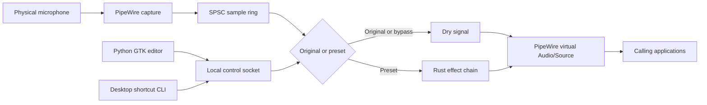

# NPCSpeech development guide

## Scope and signal path

The current product is a local, real-time effect processor for Ubuntu 26.04/PipeWire. It does not transcribe speech, synthesize words, use a hosted service, or provide a Windows audio driver yet. Python owns configuration and the GTK editor. Rust owns capture, processing, and the virtual source. The audio engine can run without the UI.

`engine/src/main.rs` handles PipeWire streams, input discovery, and output switching. `engine/src/ring.rs` is the single-producer/single-consumer sample queue between capture and output callbacks. `engine/src/dsp.rs` implements `VoiceProcessor` and the effect chain. `engine/src/control.rs` handles JSON commands outside the audio callbacks. `engine/src/preset.rs` defines the engine's preset schema. `ui/npcspeech/` contains the editor, storage, client, and command-line control.

PipeWire is the host audio service and creates the virtual source directly from the NPCSpeech process. No separate loopback application or virtual cable is required. The engine asks for 48 kHz, mono, 32-bit floating-point audio; PipeWire may adapt device and application formats. Input selection uses the PipeWire node name, not a hardware index. The first detected ALSA or Bluetooth source is selected automatically until the user chooses one. The virtual source is named `npcspeech.virtual_source` and shown as **NPCSpeech Microphone**.

## Processing and latency

The dry path copies microphone samples to the virtual source. A preset selects the wet path; bypass and Original select the dry path. A 240-frame crossfade reduces clicks when changing between dry and wet. The pitch shifter uses a 2,048-frame analysis window with a 512-frame interval at 48 kHz. Its 2,048-frame analysis latency is about 43 ms. On activation or preset change, the engine continues outputting the dry signal while the shifter warms up, then crossfades to the effect path. This avoids an initial gap and prevents old buffered speech from reappearing after bypass. The DSP chain also has formant shifting, high-pass and low-pass filters, two peaking EQ bands for body and presence, soft drive, envelope-based compression, breath texture, ring modulation, echo, and gain. The drive stage has unity small-signal gain to avoid amplifying microphone noise. Echo adds a tail but does not delay the direct signal. The `status` command reports DSP latency in frames after the output callback becomes active, plus ring overrun/underrun counters.

The four EQ fields are optional in schema version 1. Rust deserialization and Python preset validation provide neutral defaults for older preset files; save and export include the new fields. The UI restores a saved physical microphone when it becomes available again after a disconnect. Bundled examples are only installed when absent, so replacing an existing built-in preset requires an explicit backup and update rather than silently overwriting edits.

PipeWire graph quantum, device buffers, resampling, application buffers, and the pitch shifter all affect end-to-end latency. `status.latency_frames` covers only the pitch/formant component, **not** microphone-to-application latency. There is no verified end-to-end latency figure yet. Tune and measure it on target hardware before making a latency guarantee. A practical measurement is to feed a known click to the physical input, record both a direct reference and the virtual source in the same clock domain, and compare onset positions for Original and representative presets while logging PipeWire quantum and xrun counters. Avoid feedback from speakers to microphones during this test.

The callbacks use preallocated buffers and atomic control values. Keep disk I/O, JSON parsing, GUI calls, socket operations, and blocking locks outside callbacks. Physical capture is connected only while an application consumes the virtual source; a 20 ms control timer starts and stops that stream. The queue is trimmed to avoid replaying stale samples after a consumer pause or overrun. This may add a short initial silence when a calling application first opens the source. The pitch shifter is a third-party DSP library embedded through the Rust crate; validate dependency upgrades for latency, allocation behavior, and real-time safety. Target hardware and applications should be checked for sustained CPU use and audible glitches. Changing actual speaking tempo would require time stretching and buffering, so this release conveys the impression of heavy or agile voices through timbre rather than changing syllable timing.

## Preset format

Each preset is one JSON file with `schema_version: 1`, a stable lowercase `id`, display `name`, `description`, `tags`, and `effects`. See [elf.json](../presets/elf.json) for an example. The Python editor and Rust engine both validate numeric ranges. Presets are stored under the XDG config directory and written by atomic file replacement. Import never overwrites an existing preset ID; export writes a portable JSON file. Schema changes need explicit migration logic in both languages and tests for old files.

| Effect field | Meaning | Range |
| --- | --- | --- |
| `pitch_semitones` | Frequency shift | -12 to 12 |
| `formant_semitones` | Vocal tract resonance shift | -8 to 8 |
| `high_pass_hz` | Low-frequency cutoff | 20 to 800 Hz |
| `low_pass_hz` | High-frequency cutoff | 800 to 20,000 Hz |
| `drive`, `compression`, `breath` | Saturation, dynamics, breath texture | 0 to 1 |
| `modulation_hz` | Ring modulation frequency | 1 to 120 Hz |
| `modulation_mix` | Ring modulation amount | 0 to 1 |
| `echo_mix` | Echo amount | 0 to 0.6 |
| `echo_delay_ms` | Echo delay | 20 to 350 ms |
| `gain_db` | Output gain | -18 to 18 dB |

The high-pass cutoff must be lower than the low-pass cutoff. Metadata limits are enforced in both implementations. User-defined voices can use all available controls; the six bundled presets are starting points, not a closed set of creature types.

## Local control protocol

The engine listens on `$XDG_RUNTIME_DIR/npcspeech.sock` (or `$NPCSPEECH_SOCKET` when set). The socket is user-readable/writable only. One newline-delimited JSON object is sent per connection and one response is returned. Commands are `status`, `devices`, `select` (a full validated `preset` or `null` for Original), `toggle_bypass`, `set_input` (a PipeWire `node_name`), and `shutdown`. Responses contain `ok` and either result fields or `error`. `scripts/npcspeechctl` is the documented command-line client and keyboard-shortcut target. Preset selection is stored by the UI, not by the engine; the engine starts in Original mode and the UI reapplies the saved choice when it starts the engine. The UI derives its output label from the live `selected_id` and `bypass` status, so a selected preset with bypass enabled is explicitly shown as Original output. `toggle_bypass` flips state on each command; it does not require a held key.

## Extension interfaces

`VoiceProcessor` in Rust is the effect-engine boundary: block input, block output, and reported latency. A future optional neural processor should implement a worker-backed version with bounded queues and explicit delay compensation; inference must not run inside the PipeWire process callback. Its model selection and parameters should be versioned separately from DSP preset parameters. The UI should keep Original and bypass available regardless of processor.

The Windows port needs separate implementations for microphone enumeration/capture and a **shipped, signed virtual microphone driver or virtual audio device**. The current PipeWire source cannot be reused on Windows. The preset schema, control concepts, and DSP chain can be reused. A Windows driver, installer, signing, and application compatibility tests are substantial work and are not included in this version.

## Build and verification

Build with `cargo build --release --locked --manifest-path engine/Cargo.toml`. Run Rust tests with `cargo test --locked --manifest-path engine/Cargo.toml`, Python tests with `PYTHONPATH=ui python3 -m unittest discover -s tests -v`, and syntax checks with `python3 -m compileall -q ui`. CI also checks `cargo fmt --check` and `cargo clippy --all-targets -- -D warnings`.

Unit tests cover preset validation and old-file compatibility, finite and bounded DSP output, neutral silence, pitch movement, EQ response, drive level, ring behavior, bypass/selection state, JSON storage, and the Python socket client. Live PipeWire routing and subjective voice quality require a session test. Before releasing, test laptop and headset microphones, hot unplug/replug, Original and bypass transitions, selected-voice restoration, import/export, and capture in the intended calling applications. Compare the same spoken phrase in Original and each preset, using clean recordings made after confirming application routing. Record actual latency and CPU figures on the target machine instead of inferring them from buffer sizes.

`cargo run --manifest-path engine/Cargo.toml --example stretch_probe` compares pitch accuracy and DSP latency for several analysis windows using a deterministic 220 Hz tone. The 512-frame window shifted an intended one-octave drop to about 123 Hz in this test, whereas the chosen 2,048-frame window shifted it to 110 Hz. A live PipeWire diagnostic on the development machine also recorded 220 Hz through Original and 110 Hz through the processed path, with no ring overruns. This verifies routing and pitch on a tone; it does not establish subjective quality for speech or end-to-end latency in Audacity.
